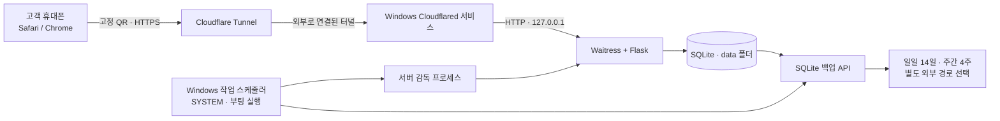
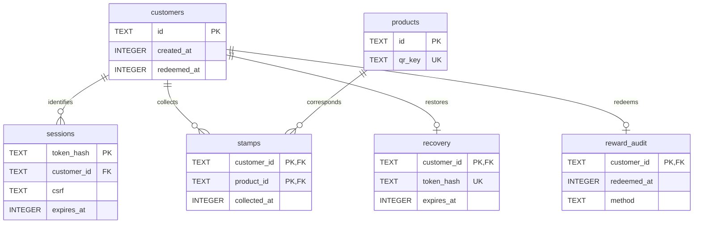

# Maison de Gourmet Stamp Collection

[](https://github.com/nuyhsp02/maison-de-gourmet-stamp/actions/workflows/ci.yml)

Maison de Gourmet의 겨울·크리스마스 시즌을 위한 **회원가입 없는 10종 상품 컬렉션 웹앱**입니다. 작은 카페가 노트북 한 대에서 운영할 수 있도록 Flask + Waitress + SQLite로 구현하고, Windows 운영·백업 절차를 함께 준비했습니다.

현재 공개 소스와 Windows 운영 준비 단계입니다. **실제 카페 운영 실적·실사용 고객 수·한 달 무중단 성과는 확인되지 않았습니다.** 동시 30명·고객 데이터 400명은 설계 목표이며 실제 장비의 보장 성능이 아닙니다.

[Windows 설치 안내](docs/WINDOWS_INSTALL.md) · [직원 매뉴얼](docs/STAFF_GUIDE.md) · [Git 사용 안내](docs/GIT_GUIDE.md) · [릴리스와 Windows 업데이트](docs/GITHUB_RELEASES.md) · [검증 결과](TEST_REPORT.md)

## 카페에서 필요한 흐름

- 시즌 음료 4종 + 지정 상품 6종을 **순서 없이 상품별 1회** 수집합니다.
- 고객은 휴대폰 기본 카메라로 상품 QR을 열고, 첫 방문에만 새 카드를 만듭니다.
- 같은 브라우저는 쿠키로 다시 인식합니다. 재방문 자동 적립은 안전 조건이 맞을 때만 POST로 처리하며, 조건이 부족하면 버튼을 제공합니다.
- 2~3종 동시 구매 시 웹 안에서 QR을 연속 스캔합니다. 카메라 권한을 거부하면 기본 카메라로 하나씩 여는 대안이 있습니다.
- 10종을 모으면 보상 지급 대기 상태가 됩니다. 직원이 실물 보상을 건넨 뒤 고객 화면에서 버튼 한 번으로 완료합니다. 직원 인증이 없어 고객도 누를 수 있다는 운영상 위험을 화면에 안내합니다.
- 완료 후 초기화하지 않고 이벤트가 끝나도 기록을 남깁니다.

UI는 민트 `#C8D7C3`, 레드 `#B61219`, 크리스마스트리 **1·2·3·4** 오너먼트 배치입니다. 사진 기반 라인드로잉과 실제 QR 보드 제작은 후속 범위입니다. [디자인 설명](app/DESIGN_NOTES.md)

## 시스템 구조



운영 코드는 `app/`, 실제 설정은 `config/`, 고객 기록은 `data/`로 분리합니다. 서버는 loopback에만 바인딩하고 외부 접속은 고정 도메인의 HTTPS 터널을 사용합니다. 포트 포워딩과 별도 클라우드 DB를 추가하지 않았습니다. GitHub는 **소스·테스트·릴리스 관리**에 사용하며 고객 DB나 실제 운영 노트북에 접속하지 않습니다.

## 기술과 선택 이유

| 구성 | 선택 이유 |
|---|---|
| Flask | 적립·복구·보상 API와 정적 모바일 화면을 작은 코드베이스에서 관리 |
| Waitress | Windows에서 사용할 수 있는 Python WSGI 서버. 개발용 디버그 서버와 분리 |
| SQLite / WAL | 단일 노트북의 파일 DB, 외래키·트랜잭션·고유 제약과 백업 API 사용 |
| Vanilla JavaScript / CSS | 별도 프런트 빌드 서버 없이 모바일 화면과 카메라 흐름 구현 |
| BarcodeDetector + 로컬 jsQR | 브라우저 지원 차이를 보완하고 외부 CDN 없이 QR 판독 |
| PowerShell / 작업 스케줄러 | Windows 기본 기능으로 설치·무인 시작·재시도·운영 관리 |
| Cloudflare Tunnel | 고정 HTTPS 주소와 서로 다른 고객 네트워크 접속을 준비 |
| pytest / Node test runner / GitHub Actions | API·DB·QR 기하·화면 상태 회귀를 자동 검사 |

운영 의존성은 [requirements-windows.lock](requirements-windows.lock)에 고정했습니다. Python 3.12/3.13 x64 일반 CPython을 대상으로 합니다. 새 프레임워크나 관리자 웹 대시보드는 도입하지 않았습니다.

## 익명 식별과 개인 복구

1. 새 카드 버튼의 POST가 고객과 세션을 만듭니다. QR GET·HEAD·미리보기 요청은 고객 생성이나 적립을 하지 않습니다.
2. 추측하기 어려운 세션 토큰을 HTTPS 환경의 `__Host-` 쿠키에 넣습니다. `Secure`, `HttpOnly`, `SameSite=Lax`, `Path=/`를 사용하고 DB에는 토큰 원문 대신 SHA-256 해시를 저장합니다.
3. 선택적 개인 복구 링크는 `/recover#토큰` 형식입니다. fragment는 일반 HTTP URL 요청에 포함되지 않으며, 고객이 복구를 실행할 때 POST 본문으로 검증합니다. DB에는 복구 토큰 해시와 만료 시각을 저장하고 재발급하면 이전 링크를 무효화합니다.
4. Host·Origin·JSON 요청·클라이언트 헤더·세션 CSRF를 검사합니다. 개인 복구 링크 자체는 소유한 사람이 기록을 복구할 수 있는 비밀이므로 공개하면 안 됩니다.

기본 카메라가 여는 브라우저와 카카오톡 등 인앱 브라우저의 저장 공간은 다를 수 있습니다. 같은 휴대폰이라도 다른 브라우저가 자동으로 같은 고객이 되는 방식은 아닙니다. 도메인이 달라지면 기존 쿠키도 자동 이전되지 않습니다.

## SQLite 구조와 중복 방지



`metadata`에는 기존 이벤트 ID·상품 ID 조합을 기록해 다른 이벤트 설정으로 기존 DB를 잘못 여는 것을 막습니다. 전체 정의는 [schema.sql](app/schema.sql)입니다.

- `stamps`의 복합 기본키 `(customer_id, product_id)`와 `INSERT OR IGNORE`로 동일 상품 중복 적립을 막습니다. 프런트의 중복 방지만 신뢰하지 않습니다.
- 단일 Waitress 프로세스에서 쓰기 요청을 순서대로 조정해 Windows의 SQLite 쓰기 잠금 경합을 줄입니다. 중복 방지의 기준은 계속 DB의 기본키/트랜잭션입니다. 다중 서버/프로세스 운영을 추가한 것은 아닙니다.
- `BEGIN IMMEDIATE` 트랜잭션으로 적립·지급의 동시 요청을 처리합니다. `reward_audit.customer_id`도 기본키이며 이미 지급한 고객은 반복 요청에 기존 상태를 돌려줍니다.
- 상품별 QR 키는 새 DB 초기화 시 생성해 DB에 보존합니다. 공개 상품 ID(`season-01` 등)는 실제 적립 QR 키가 아닙니다. **운영 QR·고객 DB·개인 복구 링크는 저장소에 포함하지 않습니다.** 테스트 QR은 localhost와 반복 문자로 만든 더미입니다.

## QR 연속 스캔

[collection-core.js](app/static/collection-core.js)가 화면 중앙 판독 영역을 실제 영상 좌표로 환산합니다. `object-fit: cover/contain`, 영상 크기와 보이는 영역을 고려하고, 같은 잘라낸 canvas를 BarcodeDetector와 jsQR에 전달합니다.

영역 밖·경계에 걸친 QR·중심을 포함하지 않는 QR은 거부합니다. 여러 QR이 보이면 임의로 첫 결과를 적립하지 않습니다. jsQR은 첫 결과 영역을 가린 뒤 다시 판독해 복수 QR 여부를 확인합니다. 연속 프레임 확인·처리 중 잠금·이미 처리한 QR 집합으로 중복 POST도 줄입니다.

좌표와 흐름 자동 테스트는 실제 카메라 검증을 대신하지 않습니다. iPhone/Galaxy의 회전·해상도·권한·인앱 브라우저는 [실기기 검증표](docs/WINDOWS_ACCEPTANCE.md)에서 확인해야 합니다.

## Windows 운영과 복구

```text
C:\MaisonCafe\
  app\       코드
  config\    실제 event.json / operations.json / 터널 토큰
  data\      실제 고객 SQLite
  backups\   검증된 일일·주간·복원 전 백업
  logs\      서버/오류/백업 기록
  scripts\   설치·감독·운영 스크립트
  .venv\     전용 Python
```

부팅 시 SYSTEM 예약 작업이 Waitress를 시작합니다. 감독 프로세스가 종료된 서버를 재시도하고, 작업 스케줄러가 감독 프로세스 오류를 재시도하도록 구성했습니다. 중복 작업·이름 있는 뮤텍스·파일 잠금을 함께 사용합니다. 터널은 별도 Windows 서비스입니다.

백업은 실행 중 DB 단순 복사가 아닌 **SQLite 백업 API**를 사용합니다. 새 백업 무결성 검사 후 일일 14일·주간 4주 보존 정책을 적용하고 외부 경로 실패를 기록합니다. 복원은 별도 후보 DB 검증부터 시작하며, 실제 활성화는 현재 DB 보존과 명시적 확인 후 진행합니다. [운영 안내](OPERATIONS.md) · [백업/복원](docs/BACKUP_RECOVERY.md)

운영 설치에는 GitHub 자동 생성 Source code ZIP 대신 **Release에 첨부된 Windows ZIP + SHA256 파일**을 사용합니다. 첨부 ZIP에는 설치 검증용 manifest가 들어갑니다. Git clone은 개발용입니다. [검증된 릴리스 반영·롤백](docs/GITHUB_RELEASES.md)

## 로컬 개발과 테스트

macOS/Linux 예시입니다. 테스트는 임시 DB를 사용하며 실제 운영 설정은 복사하지 않습니다.

```bash
python3.13 -m venv .test-venv
.test-venv/bin/python -m pip install -r requirements-test.lock
MAISON_HTTP_TESTS=1 .test-venv/bin/python -m pytest -q app/tests tests
node --test app/tests/scanner.test.cjs app/tests/app-flow.test.cjs
```

디자인/기본 흐름을 localhost에서 살펴볼 때만 다음을 사용합니다. 운영 DB와 구별되는 경로이며 실제 휴대폰 HTTPS 검증 환경은 아닙니다.

```bash
.test-venv/bin/python app/manage.py --database work/dev/collection.sqlite serve --dev --port 8765
```

Windows 개발 명령과 PowerShell 검사는 [Git 사용 안내](docs/GIT_GUIDE.md)에 있습니다. 카페 직원은 개발 명령 대신 설치된 `Manage.cmd`를 사용합니다.

## 검증 상태와 한계

V1.4 로컬 기준: Python **70개**, JavaScript **41개** 통과, PowerShell 13개 구문 및 보조 함수 3개 검사 통과. Git 도입 후 로컬 Python 검사는 기존 70개와 공개 검수·패키징과 연결 종료/쓰기 조정 회귀 14개를 합쳐 **84개 통과**했습니다. GitHub CI 결과는 [검증 보고서](TEST_REPORT.md) 및 [Actions](https://github.com/nuyhsp02/maison-de-gourmet-stamp/actions)에서 구분합니다.

Windows CI에서 DB 초기화 연결이 남아 파일 교체를 막는 문제가 드러나 `init_db` 종료 시 연결을 닫고, 단일 프로세스의 쓰기 요청을 조정하도록 보완했습니다. 스키마·적립·복구·보상 정책과 기존 운영 스크립트는 유지합니다.

CI는 Ubuntu/Windows hosted runner의 Python 3.12·3.13 테스트, 프런트 검사, Windows PowerShell 구문·보조 함수 검사, 추적 파일·도달 가능한 Git 이력 공개 검수를 수행하도록 구성했습니다. CI 성공만으로 Windows 10 실기기의 설치·로그인 전 부팅·SYSTEM 권한·터널 서비스·모바일 카메라 검증 완료를 뜻하지 않습니다. **실제 Windows 운영 서버로 자동 배포하는 작업은 없습니다.**

Windows 10 보안 업데이트 제공 상태, 실제 도메인·이벤트 기간·상품명·보상, 외부 백업 매체, 노트북 전원/절전·네트워크 정책은 운영 전에 확정해야 합니다. 세부 미검증 사항은 [Windows 인수표](docs/WINDOWS_ACCEPTANCE.md)를 참고하세요.

## 기술적 의사결정과 개발 기록

AI를 활용한 설계·구현·검수 프로젝트입니다. 확인된 코드/자동 실행 결과와 소유자의 직접 이해·재현 경험을 구분해 기록합니다.

- [ADR 6개 · 선택 근거와 위험](docs/decisions/README.md)
- [개발 로그 6개 · 문제와 검증 근거](docs/devlog/README.md)
- [포트폴리오 기록 원칙](docs/PORTFOLIO_RECORDS.md) · [새 로그 템플릿](docs/devlog/TEMPLATE.md)

캐시/JavaScript 버전 불일치 사례는 재현·원인·수정 근거가 부족해 미확인으로 표시했습니다. 회고 문서가 추가됐다는 이유로 당시 비교 검토·개인 실물 테스트·운영 성과를 새로 주장하지 않습니다.

## 버전 관리와 후속 작업

- `main`은 병합 검사 대상, `feature/*`·`fix/*`·`chore/*`·`docs/*`에서 작업 후 PR로 반영합니다.
- Git 도입 시점의 실제 V1.4 소스부터 기록합니다. V1.0~V1.3의 Git 커밋·태그를 소급 생성하지 않습니다. 기존 변경 문서는 이전 산출물의 설명입니다.
- 검증한 커밋을 `v1.4.0` 형태의 태그와 GitHub Release로 구분합니다. Windows 릴리스는 커밋된 파일만으로 만듭니다.
- 다음 검증: 실제 Windows 10 설치/재부팅/권한/장애 복구, HTTPS 터널, iPhone Safari/Galaxy Chrome.
- 이후 디자인: 실제 상품 사진 기반 라인드로잉 스탬프. QR 보드의 크기·덮개·배치는 별도 협의.

프로젝트 자체 재사용 라이선스는 아직 정하지 않았습니다. 포함된 jsQR의 Apache-2.0 라이선스와 출처는 [THIRD_PARTY.md](app/THIRD_PARTY.md)에 보존합니다. Public 공개가 별도 재사용 허가를 의미한다고 표시하지 않습니다.
