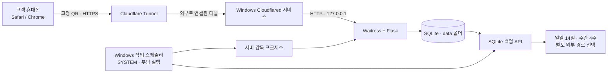
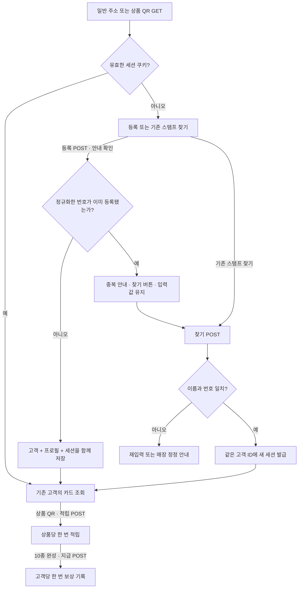
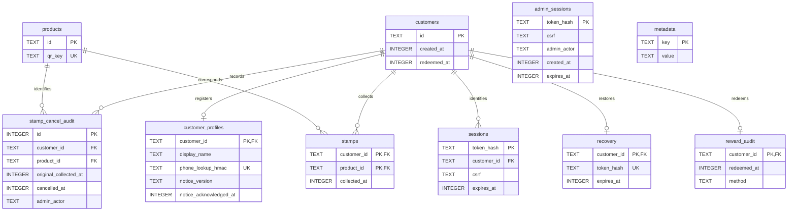

# Maison de Gourmet Stamp Collection

[](https://github.com/nuyhsp02/maison-de-gourmet-stamp/actions/workflows/ci.yml)

Maison de Gourmet의 겨울·크리스마스 시즌을 위한 **상품 10종 스탬프 카드 웹앱**입니다. 이 개발 브랜치에서는 이름과 휴대전화번호로 카드를 등록하고 다른 브라우저에서 같은 기록을 찾을 수 있습니다. Flask, Waitress, SQLite를 사용하며 기존 Windows 운영·백업 도구를 포함합니다.

**실제 카페 운영 실적·실사용 고객 수·한 달 무중단 성과는 확인되지 않았습니다.** 동시 30명·고객 데이터 400명은 설계 목표이며 실제 장비의 보장 성능이 아닙니다.

[Windows 설치 안내](docs/WINDOWS_INSTALL.md) · [격리 현장 인수 계획](docs/WINDOWS_ACCEPTANCE.md) · [직원 매뉴얼](docs/STAFF_GUIDE.md) · [Git 사용 안내](docs/GIT_GUIDE.md) · [릴리스와 Windows 업데이트](docs/GITHUB_RELEASES.md) · [검증 결과](TEST_REPORT.md)

## 어떤 버전을 어디서 사용했나요?

| 환경 | 실행 구조와 확인 범위 |
|---|---|
| Windows V1.4.0 | 노트북 한 대에서 Flask·Waitress·SQLite로 실행하도록 설계했습니다. Cloudflare Tunnel이 외부 HTTPS를 연결하며 Windows 설치 도구와 작업 스케줄러가 기동·백업을 담당합니다. [Windows 설치 안내](docs/WINDOWS_INSTALL.md) |
| Ubuntu 비공개 DEMO | 배포 당시 커밋은 `ce0b22b`입니다. Nginx가 HTTPS와 입장 인증을 처리하고 systemd가 로컬 Waitress·Flask를 실행합니다. 시연 전용 SQLite·키·직원 인증을 사용합니다. 매장 현장 검수 완료는 사용자 확인이며 정확한 검수일과 기기별 기록은 미확인입니다. [Ubuntu 운영](docs/PR3_LINUX_DEMO.md) · [암호화 백업·복원](docs/DEMO_BACKUP.md) · [기기 점검표](docs/DEMO_DEVICE_CHECKLIST.md) |
| 최신 로컬 개발 후보 | DEMO의 상품 카탈로그·직원 관리에 등록 이름과 상품별 스탬프 일러스트, 신규 합성 연락처 암호화·직원 마스킹·운영자 한 건 조회를 추가했습니다. 당시 보고 커밋은 `aaccb50`이고, 공개 후보 `bbfb27b`는 같은 앱 코드에 PR 문서의 내부 링크 교체를 반영했습니다. 실제 고객 가입과 개인정보 처리 근거는 검토 중이며 PROD 공개는 보류 상태입니다. [단계별 검증 근거](docs/evidence/portfolio-milestones-20261125.md) |

2027년 운영 정책의 배타적 경계는 한국 시각 2월 1일 0시 적립 종료, 3월 1일 0시 보상 수령 종료, 3월 31일 0시 고객 접근 종료·개인정보 파기 기준입니다. 로컬 후보는 2월 일반 직원 취소를 차단하고, 별도 관리자 자격과 사유가 있는 경우 미완성·미수령 카드의 기존 스탬프만 정정합니다. PROD 적용과 백업 보유기간은 미확정입니다. [행사·개인정보 종료 결정](docs/decisions/ADR-008-event-lifecycle.md)

## 카페에서 필요한 흐름

- 지정 상품 10종을 **순서 없이 상품별 1회** 수집합니다.
- 처음 참여하는 고객은 개인정보 안내를 확인한 뒤 이름·휴대전화번호를 다시 읽고 **[이대로 등록]**을 누릅니다. 기존 카드는 등록한 이름과 번호로 찾습니다.
- 같은 브라우저에서는 쿠키로 카드를 다시 엽니다. 상품 QR을 열거나 인앱 카메라로 판독하면 상품명이 표시됩니다. **[적립하기]**를 눌러 적립하거나 **[취소]**로 돌아갑니다. 일반 입장 QR은 바로 가입·찾기 또는 스탬프판을 엽니다.
- 2~3종 동시 구매 시 웹 안에서 QR을 연속 스캔합니다. 카메라 권한을 거부하면 기본 카메라로 하나씩 여는 대안이 있습니다.
- 10종을 모으면 보상 지급 대기 상태가 됩니다. 직원이 실물 보상을 건넨 뒤 고객 화면에서 버튼 한 번으로 완료합니다. 직원 인증이 없어 고객도 누를 수 있다는 운영상 위험을 화면에 안내합니다.
- 보상 수령 후에도 지급 완료 기록을 유지합니다. PROD의 행사 종료 후 조회와 개인정보 파기에는 위 운영 정책의 기한을 적용할 예정입니다.

UI는 민트 `#C8D7C3`, 레드 `#B61219`, 크리스마스트리 **1·2·3·4** 오너먼트 배치입니다. 초기 디자인 이후 로컬 후보에 카페 제공 스탬프 그림 10종을 적용했습니다. 사용자는 이 그림의 비상업적 포트폴리오 사용 허가를 확인했습니다. 적용 파일과 허가 범위는 [자산 안내](docs/ASSET_ATTRIBUTION.md)에 기록했습니다. [초기 디자인 설명](app/DESIGN_NOTES.md) · [고객 화면 검증](docs/devlog/DEV-011-customer-stamp-ui.md)

<a name="시스템-구조"></a>

## 기존 Windows 운영 구조



운영 코드는 `app/`, 실제 설정은 `config/`, 고객 기록은 `data/`로 분리합니다. 서버는 loopback에만 바인딩하고 외부 접속은 고정 도메인의 HTTPS 터널을 사용합니다. 포트 포워딩과 별도 클라우드 DB를 추가하지 않았습니다. GitHub는 **소스·테스트·릴리스 관리**에 사용하며 고객 DB나 실제 운영 노트북에 접속하지 않습니다.

## 기술과 선택 이유

| 구성 | 선택 이유 |
|---|---|
| Flask | 적립·복구·보상 API와 정적 모바일 화면을 작은 코드베이스에서 관리 |
| Waitress | Windows에서 사용할 수 있는 Python WSGI 서버. 개발용 디버그 서버와 분리 |
| SQLite / WAL | 단일 노트북의 파일 DB, 외래키·트랜잭션·고유 제약과 백업 API 사용 |
| Vanilla JavaScript / CSS | 별도 프런트 빌드 서버 없이 모바일 화면과 카메라 흐름 구현 |
| BarcodeDetector + 로컬 jsQR | 브라우저 지원 차이를 보완하고 외부 CDN 없이 QR 판독 |
| PowerShell / 작업 스케줄러 | Windows 기본 기능으로 설치·무인 시작·재시도·운영 관리 |
| Cloudflare Tunnel | 고정 HTTPS 주소와 서로 다른 고객 네트워크 접속을 준비 |
| pytest / Node test runner / GitHub Actions | API·DB·QR 기하·화면 상태 회귀를 자동 검사 |

운영 의존성은 [requirements-windows.lock](requirements-windows.lock)에 고정했습니다. 운영 검증 대상은 CPython 3.15.2 x64 일반 GIL입니다. 3.12/3.13은 앱 호환성 CI를 유지하지만 현재 관측된 구 SQLite는 운영 사전 검사에서 거부합니다.

## 직원용 스탬프 관리

`/admin`에서 직원 비밀번호로 로그인하면 카드·적립·보상 통계를 확인하고, 카드 ID 또는 전체 전화번호로 고객 한 명을 찾을 수 있습니다. 일반 직원은 적립 마감 전까지 미수령 카드의 상품 하나를 확인 후 취소할 수 있습니다. 취소와 감사 기록은 함께 저장됩니다. [관리자 예외 정정 결정](docs/decisions/ADR-009-stamp-corrections.md) · [정정 검증 기록](docs/devlog/DEV-017-stamp-corrections.md) · [관리자 설정·ERD·검증 보고서](docs/PR2_STAFF_ADMIN.md) · [합성 데이터 화면](docs/evidence/admin-pr2-demo.png)

<a name="익명-식별과-개인-복구"></a>

## 고객 등록과 기존 스탬프 찾기

1. 등록 POST에서 정규화한 번호의 HMAC을 확인하고 한 트랜잭션으로 고객·프로필·세션을 저장합니다. 이미 등록된 번호는 찾기 버튼으로 안내합니다. 입력값은 현재 폼에 유지되며 찾기 POST에서 이름과 번호가 모두 일치하면 원래 고객 ID에 새 세션을 발급합니다.
2. 추측하기 어려운 세션 토큰을 HTTPS 환경의 `__Host-` 쿠키에 넣습니다. `Secure`, `HttpOnly`, `SameSite=Lax`, `Path=/`를 사용하고 DB에는 토큰 원문 대신 SHA-256 해시를 저장합니다.
3. 선택적 개인 복구 링크는 `/recover#토큰` 형식입니다. fragment는 일반 HTTP URL 요청에 포함되지 않으며, 고객이 복구를 실행할 때 POST 본문으로 검증합니다. DB에는 복구 토큰 해시와 만료 시각을 저장하고 재발급하면 이전 링크를 무효화합니다.
4. Host·Origin·JSON 요청·클라이언트 헤더·세션 CSRF를 검사합니다. 개인 복구 링크 자체는 소유한 사람이 기록을 복구할 수 있는 비밀이므로 공개하면 안 됩니다.

기본 카메라가 여는 브라우저와 앱 내부 브라우저는 쿠키 저장소가 다를 수 있습니다. 등록한 카드는 이름·전화번호로 다시 찾을 수 있습니다. 프로필 도입 전 익명 카드는 기존 쿠키나 개인 복구 링크로 엽니다.



## DEMO 기준 SQLite 구조와 중복 방지



`metadata`에는 기존 이벤트·상품 ID 서명과 전화번호 검색 비밀 키의 확인값을 저장합니다. 기존 익명 고객은 프로필 0개, 신규 등록 고객은 프로필 1개입니다. PR 1과 DEMO에서는 전화번호 검색키(HMAC)만 보관합니다. 최신 로컬 후보는 이 검색키를 유지하고 신규 합성 가입 시에만 별도 공개키로 전체 연락처를 암호화합니다. 기존 카드를 찾을 때 번호를 소급 저장하지 않습니다. [스키마](app/schema.sql) · [DB와 검색 키의 격리 복원](docs/BACKUP_RECOVERY.md) · [PR 1 기록](docs/PR1_CUSTOMER_PROFILES.md) · [후속 연락처 보호 설계](docs/decisions/ADR-007-contact-privacy.md)

- `stamps`의 복합 기본키 `(customer_id, product_id)`와 `INSERT OR IGNORE`로 동일 상품 중복 적립을 막습니다. 프런트의 중복 방지만 신뢰하지 않습니다.
- 단일 Waitress 프로세스에서 쓰기 요청을 순서대로 조정해 Windows의 SQLite 쓰기 잠금 경합을 줄입니다. 중복 방지의 기준은 계속 DB의 기본키/트랜잭션입니다. 다중 서버/프로세스 운영을 추가한 것은 아닙니다.
- `BEGIN IMMEDIATE` 트랜잭션으로 적립·지급의 동시 요청을 처리합니다. `reward_audit.customer_id`도 기본키이며 이미 지급한 고객은 반복 요청에 기존 상태를 돌려줍니다.
- 상품별 QR 키는 새 DB 초기화 시 생성해 DB에 보존합니다. 공개 상품 ID(`season-01` 등)는 실제 적립 QR 키가 아닙니다. **운영 QR·고객 DB·개인 복구 링크는 저장소에 포함하지 않습니다.** 테스트 QR은 localhost와 반복 문자로 만든 더미입니다.

## QR 연속 스캔

[collection-core.js](app/static/collection-core.js)가 화면 중앙 판독 영역을 실제 영상 좌표로 환산합니다. `object-fit: cover/contain`, 영상 크기와 보이는 영역을 고려하고, 같은 잘라낸 canvas를 BarcodeDetector와 jsQR에 전달합니다.

영역 밖·경계에 걸친 QR·중심을 포함하지 않는 QR은 거부합니다. 여러 QR이 보이면 임의로 첫 결과를 적립하지 않습니다. jsQR은 첫 결과 영역을 가린 뒤 다시 판독해 복수 QR 여부를 확인합니다. 연속 프레임 확인·처리 중 잠금·이미 처리한 QR 집합으로 중복 POST도 줄입니다.

좌표와 흐름 자동 테스트는 실제 카메라 검증을 대신하지 않습니다. iPhone/Galaxy의 회전·해상도·권한·인앱 브라우저는 [실기기 검증표](docs/WINDOWS_ACCEPTANCE.md)에서 확인해야 합니다.

## Windows 운영과 복구

```text
C:\MaisonCafe\
  app\       코드
  config\    실제 event.json / operations.json / 터널 토큰
  data\      실제 고객 SQLite
  backups\   검증된 일일·주간·복원 전 백업
  logs\      서버/오류/백업 기록
  scripts\   설치·감독·운영 스크립트
  .venv\     전용 Python
```

부팅 시 SYSTEM 예약 작업이 Waitress를 시작합니다. 감독 프로세스가 종료된 서버를 재시도하고, 작업 스케줄러가 감독 프로세스 오류를 재시도하도록 구성했습니다. 중복 작업·이름 있는 뮤텍스·파일 잠금을 함께 사용합니다. 터널은 별도 Windows 서비스입니다.

백업은 실행 중 DB 단순 복사가 아닌 **SQLite 백업 API**를 사용합니다. 새 백업 무결성 검사 후 일일 14일·주간 4주 보존 정책을 적용하고 외부 경로 실패를 기록합니다. 복원은 별도 후보 DB 검증부터 시작하며, 실제 활성화는 현재 DB 보존과 명시적 확인 후 진행합니다. [운영 안내](OPERATIONS.md) · [백업/복원](docs/BACKUP_RECOVERY.md)

운영 설치에는 GitHub 자동 생성 Source code ZIP 대신 **Release에 첨부된 Windows ZIP + SHA256 파일**을 사용합니다. 첨부 ZIP에는 설치 검증용 manifest가 들어갑니다. Git clone은 개발용입니다. [검증된 릴리스 반영·롤백](docs/GITHUB_RELEASES.md)

## 로컬 개발과 테스트

macOS/Linux 예시입니다. 테스트는 임시 DB를 사용하며 실제 운영 설정은 복사하지 않습니다.

```bash
python3.13 -m venv .test-venv
.test-venv/bin/python -m pip install -r requirements-test.lock
MAISON_HTTP_TESTS=1 .test-venv/bin/python -m pytest -q app/tests tests
node --test app/tests/scanner.test.cjs app/tests/app-flow.test.cjs app/tests/admin-flow.test.cjs
```

디자인/기본 흐름을 localhost에서 살펴볼 때만 다음을 사용합니다. 운영 DB와 구별되는 경로이며 실제 휴대폰 HTTPS 검증 환경은 아닙니다.

```bash
.test-venv/bin/python app/manage.py --database work/dev/collection.sqlite serve --dev --port 8765
```

Windows 개발 명령과 PowerShell 검사는 [Git 사용 안내](docs/GIT_GUIDE.md)에 있습니다. 카페 직원은 개발 명령 대신 설치된 `Manage.cmd`를 사용합니다.

## 검증 상태와 한계

V1.4 로컬 기준: Python **70개**, JavaScript **41개** 통과, PowerShell 13개 구문 및 보조 함수 3개 검사 통과. Git 도입 후 로컬 Python 검사는 기존 70개와 공개 검수·패키징과 연결 종료/쓰기 조정 회귀 14개를 합쳐 **84개 통과**했습니다. GitHub CI 결과는 [검증 보고서](TEST_REPORT.md) 및 [Actions](https://github.com/nuyhsp02/maison-de-gourmet-stamp/actions)에서 구분합니다.

Windows CI에서 DB 초기화 연결이 남아 파일 교체를 막는 문제가 드러나 `init_db` 종료 시 연결을 닫고, 단일 프로세스의 쓰기 요청을 조정하도록 보완했습니다. 스키마·적립·복구·보상 정책과 기존 운영 스크립트는 유지합니다.

CI는 Ubuntu/Windows hosted runner의 Python 3.12·3.13·3.15.2 호환성 테스트 및 Windows 3.15.2 운영 엔진 검사, 프런트 검사, Windows PowerShell 구문·보조 함수 검사, 추적 파일·도달 가능한 Git 이력 공개 검수를 수행하도록 구성했습니다. CI 성공만으로 Windows 10 실기기의 설치·로그인 전 부팅·SYSTEM 권한·터널 서비스·모바일 카메라 검증 완료를 뜻하지 않습니다. **실제 Windows 운영 서버로 자동 배포하는 작업은 없습니다.**

Windows 10 보안 업데이트 제공 상태, 실제 도메인·이벤트 기간·상품명·보상, 외부 백업 매체, 노트북 전원/절전·네트워크 정책은 운영 전에 확정해야 합니다. 세부 미검증 사항은 [Windows 인수표](docs/WINDOWS_ACCEPTANCE.md)를 참고하세요.

## 기술적 의사결정과 개발 기록

AI를 활용한 설계·구현·검수 프로젝트입니다. 확인된 코드/자동 실행 결과와 소유자의 직접 이해·재현 경험을 구분해 기록합니다.

- [ADR 색인 · V1.4.0의 여섯 결정과 후속 결정](docs/decisions/README.md)
- [개발 로그 · 문제와 검증 근거](docs/devlog/README.md)
- [포트폴리오 기록 원칙](docs/PORTFOLIO_RECORDS.md) · [새 로그 템플릿](docs/devlog/TEMPLATE.md)

Windows 노트북과 공개 CI에서 출발해 Ubuntu 비공개 DEMO를 배포한 과정, 이후 로컬 UI·연락처 개선과 PROD 출시 준비 조사를 [단계별 근거표](docs/evidence/portfolio-milestones-20261125.md)에서 추적할 수 있습니다. 2026-11-25 기준 마지막 DEMO 배포 기록은 `ce0b22b`, 개인정보 기능의 당시 로컬 검토 기준은 `aaccb50`입니다. 배포 당시 SHA와 두 차례 정비 후 SHA는 [DEV-015 대응표](docs/devlog/DEV-015-public-history-and-asset-permission.md)에서 대조할 수 있습니다. 후속 사용자 결정과 아직 구현할 항목은 [연락처 보호](docs/decisions/ADR-007-contact-privacy.md)와 [행사·개인정보 종료](docs/decisions/ADR-008-event-lifecycle.md)에 기록했습니다. PROD 공개는 대기 중입니다.

캐시/JavaScript 버전 불일치 사례는 재현·원인·수정 근거가 부족해 미확인으로 표시했습니다. 회고 문서가 추가됐다는 이유로 당시 비교 검토·개인 실물 테스트·운영 성과를 새로 주장하지 않습니다.

## 버전 관리와 후속 작업

- `main`은 병합 검사 대상, `feature/*`·`fix/*`·`chore/*`·`docs/*`에서 작업 후 PR로 반영합니다.
- Git 도입 시점의 실제 V1.4 소스부터 기록합니다. V1.0~V1.3의 Git 커밋·태그를 소급 생성하지 않습니다. 기존 변경 문서는 이전 산출물의 설명입니다.
- 검증한 커밋을 `v1.4.0` 형태의 태그와 GitHub Release로 구분합니다. Windows 릴리스는 커밋된 파일만으로 만듭니다.
- Windows 후보의 후속 검증: 실제 Windows 10 설치/재부팅/권한/장애 복구, HTTPS 터널, iPhone Safari/Galaxy Chrome.
- V1.4.0 당시에는 사진 기반 라인드로잉과 QR 보드 크기·덮개·배치를 후속 작업으로 남겼습니다.

프로젝트 자체 재사용 라이선스는 아직 정하지 않았습니다. 포함된 jsQR의 Apache-2.0 라이선스와 출처는 [THIRD_PARTY.md](app/THIRD_PARTY.md)에 보존합니다. Public 공개가 별도 재사용 허가를 의미한다고 표시하지 않습니다.

B 트랜잭션 잠금 후보의 [검증 및 운영 차단 항목](docs/devlog/DEV-007-transaction-write-scope.md)과 [한국어 백엔드 학습 안내](docs/BACKEND_LEARNING.md)를 제공합니다. [공식 Python 3.15.2 검증](docs/devlog/DEV-008-python315-runtime.md)을 추가했습니다. 코드 검토와 현장 운영 승인은 별개이며 새 릴리스는 아직 없습니다.

Windows 후보의 운영 전 검증은 [현장 인수 계획](docs/WINDOWS_ACCEPTANCE.md)의 실제 Waitress HTTP 시나리오·미승인 제안 기준과 [빈 결과 양식](docs/evidence/FIELD_ACCEPTANCE_TEMPLATE.md)을 사용합니다. [2026-11-01 Windows 10 실장비 HTTP 합성 시험](docs/evidence/windows10-http-2026-11-01-7667f5c.md)은 사용자 전달 출력 기준으로 9개 사례·47고객/237스탬프/1지급과 정합성 정상입니다. 원본 JSON 독립 대조는 미완료이며 전체 현장 인수는 `not_performed`입니다. 보안/ESU는 보류, HTTPS·휴대폰·자동 시작·장시간 운영은 미실행이고 [DEV-009](docs/devlog/DEV-009-b-admission-bounded-investigation.md)의 간헐 admission timeout은 미해결입니다. PR #4 Draft 해제·병합·운영 배포를 승인하지 않습니다.

시험 후보 패키지와 실제 HTTP 도구의 [실행 순서·Windows 명령](docs/FIELD_SETUP.md)을 제공합니다. 도구는 새 합성 DB만 사용하며 Windows 10·HTTPS·휴대폰 인수는 별도입니다.

[2026-11-01 Windows 10 수동 Waitress 실행](docs/evidence/windows10-manual-server-2026-11-01-7667f5c.md)도 사용자 전달 관측으로 별도 보존했습니다. PID와 127.0.0.1:8875 일치·health 정상·Ctrl+C 뒤 리스너 종료·빈 합성 DB 0/0/0 유지를 확인한 범위이며 원본 로그/DB는 미확보입니다. [HTTPS·실물 휴대폰 후속](docs/FIELD_SETUP.md#후속-계획-격리-https와-실물-휴대폰-시험)은 보안·격리·변경 승인을 포함한 **계획만**입니다. 해당 Windows 수동 시험에서는 HTTPS·브라우저 적립·카메라·Cloudflare·자동 실행·카페 운영을 검증하지 않았습니다.
