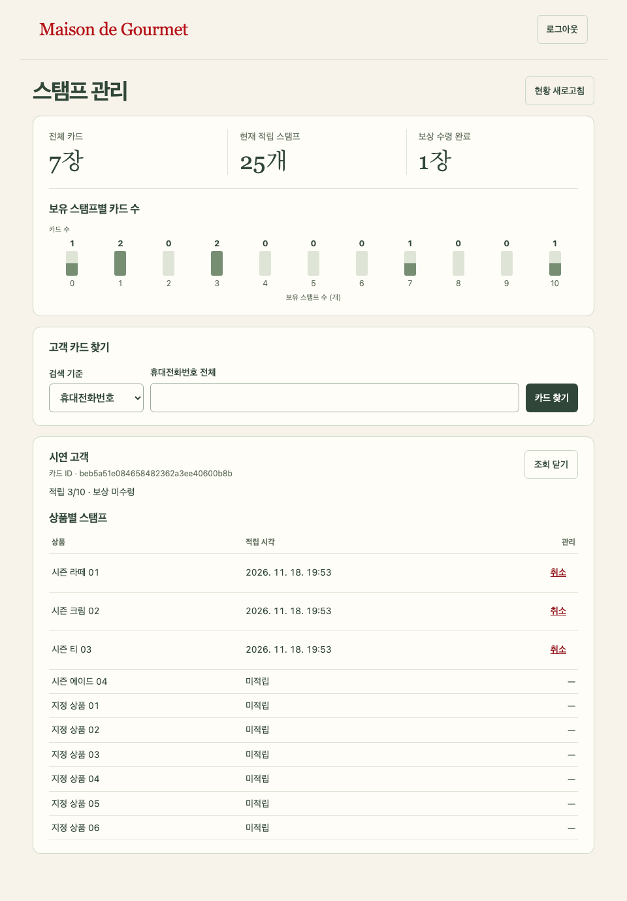
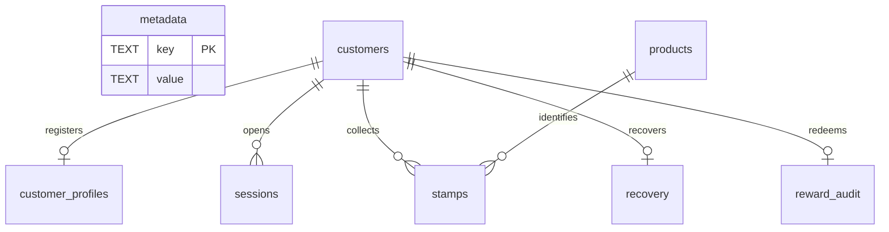
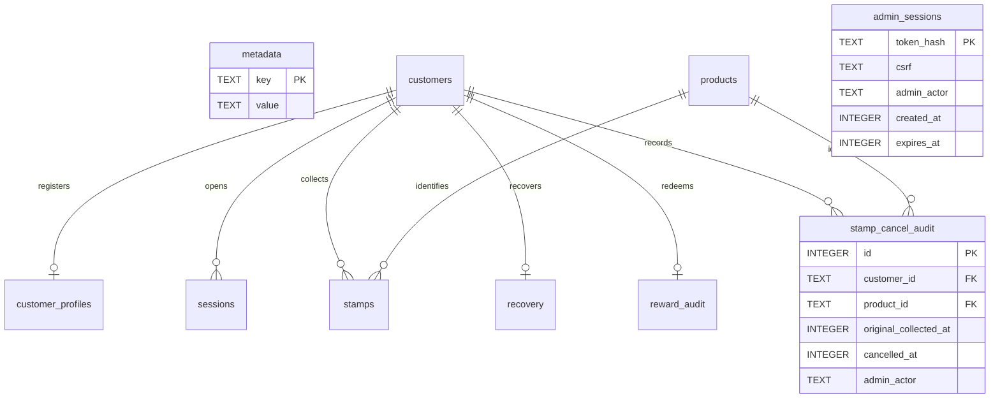
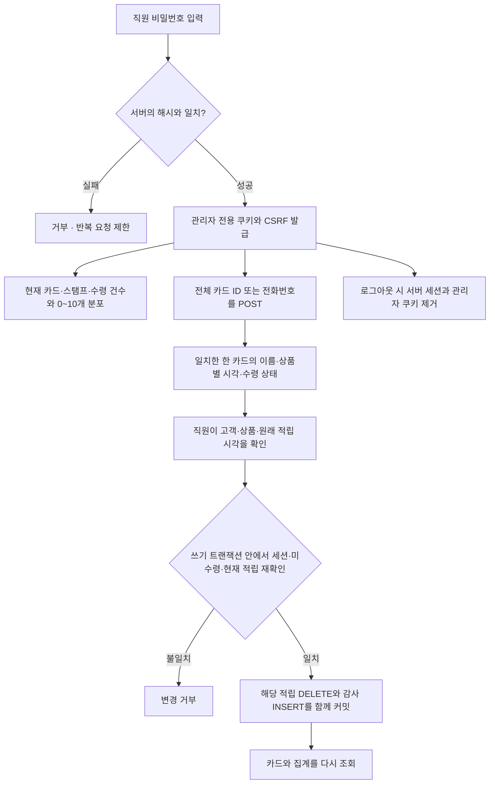

# PR 2 · 직원용 스탬프 관리

2026-11-18 로컬 개발·검증 기록. 직원은 `/admin`에서 비밀번호로 로그인해 운영 현황을 보고 카드 한 장을 조회할 수 있다. 특정 상품의 적립을 취소하면 감사 기록이 남는다. 보상을 수령한 카드는 조회만 가능하다. 고객은 기존 스탬프판에서 실물 지급을 확인하며 직원 PIN을 입력할 필요가 없다. 내부 확정 설계와 결정 D41의 구현은 [변경 전후 ERD](#변경-전후-erd) 및 [구현 판단과 영향](#구현-판단과-영향)에서 확인할 수 있다.



## 작업 기준

GitHub의 main은 `cceed35`, 열린 Draft PR #4의 head는 `ed9912a`였다. 로컬 `feature/pr1-customer-profiles`의 `f1919cd`는 #4 head의 바로 다음 커밋이며 작업 트리는 깨끗했다. 별도 사본의 `feature/pr2-staff-admin`을 `f1919cd`에서 분기했다. PR 2만 검토하는 명령은 `git diff f1919cd...feature/pr2-staff-admin`이다. [Draft PR #4](https://github.com/nuyhsp02/maison-de-gourmet-stamp/pull/4)

## 변경 전후 ERD

**PR 1에는 고객 카드와 이벤트를 관리하는 테이블 8개가 있었다.**



**PR 2에서는 관리자 세션과 취소 감사 기록을 더해 10개가 된다.** 세션이 종료되거나 적립 행이 삭제되어도 취소 이력이 남도록, 감사 행은 영구적인 고객·상품 ID를 참조하고 작업 당시 계정 ID를 자체 보관한다.



기존 8개 테이블의 열과 키는 유지한다. 이관 트랜잭션에서 `metadata`에 `admin_schema_v1`을 기록하고 감사 조회 인덱스와 수령 후 적립 삭제를 거부하는 `protect_redeemed_stamp` 트리거를 만든다. 시작 및 Windows 복원 후보 검사에서는 버전 표시와 새 테이블·트리거의 존재를 대조한다. [실제 스키마](../app/schema.sql) · [키와 DB 복원](BACKUP_RECOVERY.md)

## 변경 전후 데이터 흐름

**PR 1 고객 경로**는 등록·찾기 또는 유효한 쿠키 → 카드 조회 → 상품 QR을 확인한 뒤 적립 POST → 10종 완성 → 고객 화면의 지급 완료 POST → 지급 기록 1건이다. QR의 GET·HEAD 자체는 적립하지 않는다. PR 2에서도 이 경로를 그대로 사용한다.



통계는 이름을 등록하기 전 익명 카드를 포함한 **전체 카드 수**, 현재 남아 있는 **적립 행 수**, **0~10개 보유 구간별 카드 수**, `redeemed_at`이 있는 **수령 완료 카드 수**를 한 SQL 문에서 산출한다. 적립을 취소하면 현재 적립 수와 해당 구간 분포가 함께 바뀐다.

## 직원 비밀번호 설정

단일 행사·단일 Waitress 프로세스에서 **직원용 계정 하나**를 사용한다. 아래 명령은 저장소 루트에서 별도 데모 경로의 검증 파일을 설정하는 예다. 이 명령 자체는 DB를 열지 않는다.

```sh
python app/manage.py --database work/demo/collection.sqlite admin-password --actor store-demo
```

- 담당자는 대화형 터미널에서 12~256자의 비밀번호를 두 번 입력한다. 명령줄 인수나 환경 변수에 비밀번호를 넣을 필요가 없다. SHA-256 기반 PBKDF2를 100만 회 적용한 소금값 포함 검증값과 계정 ID만 `collection.sqlite.admin.key`에 기록한다. 파일은 POSIX에서 소유자 읽기·쓰기 권한으로 만들며 Windows에서는 비공개 데이터 디렉터리의 ACL을 상속한다.
- 설정 파일이 없거나 형식이 잘못되면 직원 로그인이 차단된다. 비밀번호를 바꿀 때는 같은 명령을 다시 실행한다. 새 검증값으로 교체한 뒤 기존 관리자 쿠키는 다음 권한 확인에서 거부된다. 여러 직원이 계정을 공유하면 감사 기록에서 확인되는 것은 계정 ID까지다.
- SQLite 백업에는 프로필·취소 이력이 들어간다. 전화번호 찾기에 필요한 원래 `.profile.key`를 보관하고, 별도 `.admin.key`는 안전하게 복원하거나 새로 설정한다. 서버 재시작 또는 DB 복원 후 직원은 다시 로그인한다. 고객의 쿠키와 복구 링크는 기존 정책을 따른다.

## 구현 판단과 영향

| 항목 | 선택과 이유 |
|---|---|
| 인증 경계 | 운영 HTTPS에서 `__Host-stamp-admin` 쿠키를 Secure·HttpOnly·SameSite=Strict로 발급한다. 절대 만료는 8시간이다. 세션 조회값은 프로세스별 비밀과 현재 계정 설정에 묶는다. 재시작 시 로그아웃을 감수해 과거 백업에서 직원의 세션이 되살아나지 않게 했다. |
| 요청 제한·CSRF | 비밀번호 검증 전 IP당 분당 5회, 프로세스 전체 분당 30회로 로그인 시도를 제한한다. 성공도 포함한다. 모든 POST는 기존 Origin·전용 클라이언트 헤더·JSON 검사를 거친다. 로그인 이후 검색·취소·로그아웃은 별도의 `X-Admin-CSRF`도 요구한다. |
| 조회 범위 | 전체 번호를 기존 PR 1 규칙으로 정규화한 뒤 같은 HMAC으로 검색한다. 응답은 일치한 한 카드의 ID·이름·10개 상품의 상태/적립 시각·수령 시각만 제공한다. 전화번호 원문·끝자리·검색값·QR 키는 반환하지 않는다. 이름 없는 익명 카드는 ID를 이미 알고 있을 때 조회할 수 있다. |
| 취소 단위 | 취소 확인 때 본 고객·상품과 마지막 취소 이력 번호를 함께 보낸다. 같은 초에 취소 후 다시 적립해도 이전 화면의 요청이 새 도장을 지울 수 없다. 지급과 취소는 기존 `BEGIN IMMEDIATE` 경로를 공유한다. 감사 INSERT가 실패하면 DELETE도 롤백한다. |
| 시연 화면 | 로그아웃·만료·페이지 이탈 시 상세 정보를 지운다. 취소 후 집계와 상세 재조회가 끝나야 다음 검색을 받는다. 취소가 저장된 후 화면 갱신만 실패한 경우에는 그 두 결과를 구분해 표시한다. |

승인된 취소·지급 정책은 변경하지 않았다. 직원 개인별 계정, 수령 취소, 전체 초기화, 연락처 수정, 일괄 내보내기 기능은 이번 관리자 화면에 없다.

## 실제 검증 결과

macOS 15.7.9 x86_64, CPython 3.13.5, SQLite 3.45.3, Node.js 18.18.0을 사용했다. 아래 `python`은 프로젝트 테스트 의존성을 설치한 이 인터프리터를 가리킨다. 두 사본에서 실행한 pytest 수집 결과를 대조한 결과 PR 1의 150개 테스트 ID가 PR 2에도 모두 있었다.

| 실행 위치와 명령 | 통과 | 실패 | 생략 |
|---|---:|---:|---:|
| PR 1 · `MAISON_HTTP_TESTS=1 python -m pytest -q app/tests tests` | 150 (113.79초) | 0 | 0 |
| PR 1 · `node --test app/tests/scanner.test.cjs app/tests/app-flow.test.cjs` | 45 (8.14초) | 0 | 0 |
| PR 2 · `MAISON_HTTP_TESTS=1 python -m pytest -q app/tests tests --junitxml=../../work/pr2-python-final.xml` | **167** (165.27초) | 0 | 0 |
| PR 2 · `node --test app/tests/scanner.test.cjs app/tests/app-flow.test.cjs app/tests/admin-flow.test.cjs` | **52** (6.56초) | 0 | 0 |

**추가된 Python 17개**는 관리자 API 13개, PR 1 DB 이관 1개, 운영 백업·복원 2개, 이름이 바뀐 비밀번호 검증 파일의 공개 차단 1개다. **추가된 JavaScript 7개**는 인증 전후, 개인정보 지우기, 취소 확인, 상태 충돌, 세션 변경·종료와 늦은 응답 처리를 다룬다. [관리자 API 검사](../app/tests/test_admin.py) · [이관 검사](../app/tests/test_admin_migration.py) · [화면 검사](../app/tests/admin-flow.test.cjs)

| 시나리오 | 관측 결과 |
|---|---|
| 관리자 권한 | 비로그인·고객 쿠키로 관리자 데이터에 접근할 수 없었다. 잘못된 비밀번호 반복 제한, 다른 CSRF 거부, 세션 만료·로그아웃·비밀번호 교체·재시작 후 재로그인을 확인했다. |
| 집계·검색 | 익명 카드와 적립 0개인 카드를 포함해 총계와 구간 합이 일치했다. 같은 번호의 다른 표기와 카드 ID로 동일 카드를 찾았다. 권한 있는 상세 응답에만 이름이 보였고 URL·리퍼러·접근 로그·브라우저 저장소에서 합성 개인정보나 비밀번호를 발견하지 못했다. |
| 취소·감사 | 선택한 적립 1개와 원래 적립 시각·취소 시각·고객·상품·계정 ID를 대조했다. 감사 저장 실패 시 삭제가 롤백됐다. 같은 초에 다시 적립한 도장은 오래된 취소 요청으로 지워지지 않았다. |
| 지급과 경합 | 서로 다른 앱 인스턴스에서 같은 적립의 취소/취소, 10종 완성 카드의 한 적립 취소/고객 지급을 경합시켰다. 각 시험에서 한쪽만 성공했고 적립·지급·취소 이력이 일치했다. 수령 후 API 취소와 직접 SQL DELETE도 거부됐다. |
| 이관·복원 | `f1919cd`의 스키마로 합성 DB를 만든 뒤 격리 사본을 두 번 시작했다. 원본 파일·프로필 키·기존 세션·복구 링크·10개 QR·지급 기록을 대조했다. 취소 후 백업을 복원해 감사 행과 고객 세션이 유지되고 백업 당시의 직원 쿠키는 거부되는 것을 확인했다. 감사 테이블이 빠진 복원 후보는 거부됐다. |
| 실제 브라우저 | 자체 서명 로컬 HTTPS에서 Chrome Headless 152.0.7977.75로 인증 → 조회 → 취소 확인 → 로그아웃을 실행했다. 합성 카드 7장의 스탬프가 25개에서 24개로 줄었고 감사 행 1개가 생겼다. 두 탭의 로그아웃과 320·375·390·412·960px 너비에서 가로 넘침이 없음을 확인했다. |
| 화면 오류 복구 | 취소 직후 통계 조회만 실패했을 때 늦은 상세 응답이 다음 검색을 덮을 수 있는 경합을 추가 테스트로 재현했다. 두 조회가 모두 끝난 후 입력을 다시 허용하도록 수정했고 최종 검사에서 통과했다. |

추가로 `python tests/cross_runtime315.py --legacy /usr/bin/python3`에서 SQLite 3.43.2로 만든 익명 카드·QR·쿠키를 3.45.3에서 복구해 지급 1회를 확인했다. `python tools/field_http.py run --out ../../work/field-pr2 --tooling-smoke`의 5·10·30클라이언트 Waitress 검사, 응답 유실 처리와 재시작·복원도 통과했다. 최종 합성 DB는 카드 47장·스탬프 237개·지급 1건이었고 무결성·외래키·중복 검사에서 이상이 없었다. `python tools/audit_public.py --staged`의 추적 대상 145개에서도 탐지 항목은 0개였다.

## 11월 25일 비공개 시연 전

1. 접근을 제한한 외부 HTTPS DEMO 주소, 독립 DB·QR·프로필 키, 직원 계정 담당자를 정한다. 데모 직원 비밀번호는 배포 대상에서 별도로 설정한다.
2. 직원 기기와 휴대폰 두 대에서 로그인 → 번호 찾기 → 적립 취소 → 고객 화면 재조회 → 재적립·수령 → 수령 후 취소 차단 → 로그아웃을 확인한다. 외부 접속, 실제 카메라, 브라우저 간 복구, 백업을 격리 복원한 후의 재로그인이 현장 확인 대상이다.
3. 시연 데이터를 가상 고객으로 제한하고 실제 공개 전 개인정보 처리·보유 및 파기 기준, 계정 공유 책임과 비밀번호 인계를 확정한다. 고객 화면에서 소지자가 직접 지급 완료를 누를 수 있는 기존 정책을 담당자에게 설명한다.
4. PR #4와 로컬 PR 1의 통합 순서, 대상 서버의 SQLite 런타임과 이관 경로를 정한다. 기존 V1.4 앱 전용 업데이트기는 스키마 및 운영 스크립트 차이를 거부한다. 이번 작업에서는 구매·배포·원격 push·병합 또는 실제 데이터 이관을 수행하지 않았다.
