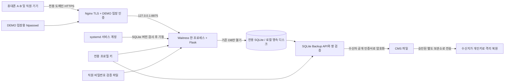
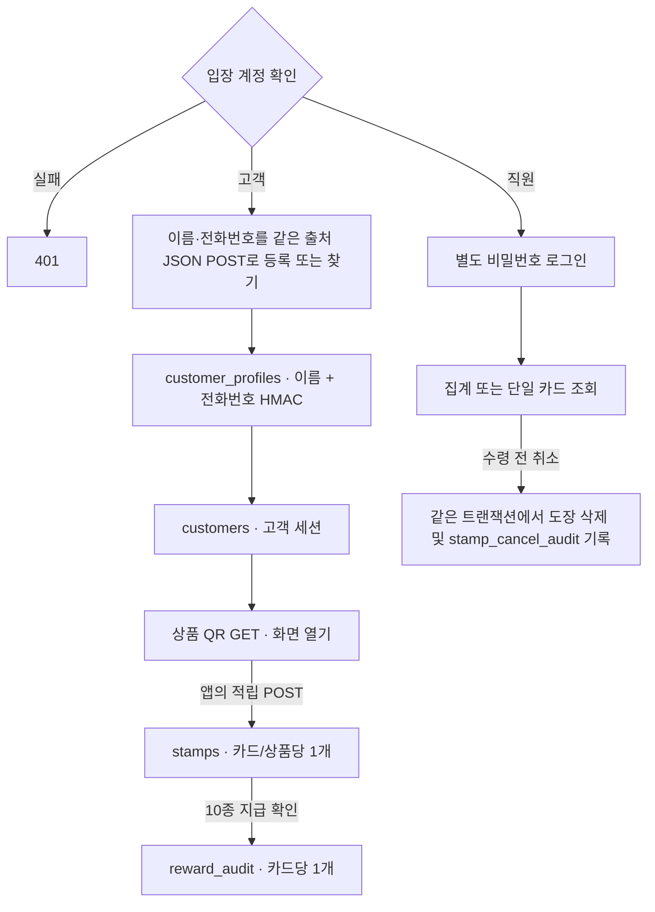

# PR 3 · 비공개 Ubuntu DEMO 운영 안내

목표는 2026-11-25 매장 담당자, 발표자, 직원 기기만 합성 카드로 같은 행사를 이용하는 것이다. 시작점은 Draft #4 `ed9912a` → 고객 등록·찾기 `f1919cd` → 직원 관리 `aa006a7`이다. 이 브랜치에는 설치할 파일과 시험 결과가 있다. 외부 접속을 열기 위한 조건과 당일 합격 기준은 아래 점검표에서 확인한다. 내부 결정 D27·D30·D34·D41의 적용 범위는 [배포 구조와 신뢰 경계](#배포-구조와-신뢰-경계), 선행 직원 기능은 [PR 2 구현 기록](PR2_STAFF_ADMIN.md)에서 확인할 수 있다. · [실행 기록](evidence/pr3-linux-tests.txt) · [당일 점검표](DEMO_DEVICE_CHECKLIST.md)

## 확인한 결과와 11월 25일 준비도

Ubuntu 24.04.5에서 최종 Python **214개**, JavaScript **53개**가 통과했다. Python은 PR 2에 있던 167개에 기동·실패 처리 32개, 백업·복원 9개, Nginx·서비스 2개, 비공개 파일 검사 4개를 더했다. JavaScript는 기존 52개와 스캔 간격 경계 1개다. 원본 PR 1·PR 2 작업 트리는 각자 원래 커밋에 있다.

- 실제 Nginx와 Waitress 사이에서 임시 TLS 인증서를 신뢰한 클라이언트로 확인했다. 입장 자격이 없으면 401, 다른 Origin으로 등록을 시도하면 403, 게이트·고객 쿠키만으로 직원 통계를 열면 401이었다. QR GET 후 0개, 같은 적립 POST를 두 번 보낸 뒤 1개, 다른 쿠키로 복구한 뒤에도 1개였다. 접근 로그에서 시각·상태·응답 크기 형식을 검사하고, 생성한 개인정보·인증 정보·QR 값의 유출을 대조했다.
- 기존 Waitress 부하 도구의 5→10→30 동시 클라이언트 단계를 모두 통과했다. 15초 쓰기 잠금 타임아웃을 의도적으로 일으킨 뒤 재시도해 중복 지급과 데이터 유실 여부도 확인했다. 장비별 최대 처리량 보장은 현장 인수에서 판단한다.
- 네트워크·볼륨 공유가 없는 두 Ubuntu 컨테이너를 송신자와 보관자로 사용했다. 보관자는 개인키를 유지하고 송신자는 암호문만 건넸다. 복원된 카드 2장, 적립 11건, 지급·취소 각 1건, 상품 QR 키 10개와 프로필 키가 일치했다. 새로운 세션 2개에서 기존 카드를 찾았으며 수령 상태가 유지됐다.
- 전용 Ubuntu 게스트에서 systemd 기본 부팅 등록과 실제 Nginx·앱 기동을 확인했다. 1 CPU·512 MiB TCG의 첫 시도는 SQLite 사전 검사에서 시작 시한을 넘겼고, systemd가 재시도해 수정 범위 검사 통과 후 앱을 시작했다. 이후 게스트 관찰이 중단돼 실행 중 프로세스 강제 종료 후 PID 교체와 재부팅 전후 카드·키 대조는 미검증이다. 대상 서버에서 두 유닛 자동 시작, 영속 마운트, 기동 시간 및 데이터 보존을 확인해야 한다.
- 외부 공개 여부는 승인된 **실도메인·대상 서버·독립 보관 장치·휴대폰 2대 및 직원 기기**에서 결정한다. 도메인이나 입장 계정을 확보하지 못하면 외부 시연은 열 수 없다. 키 쌍이 없는 백업으로는 기존 카드를 복구할 수 없다. [기기별 인수 기준](DEMO_DEVICE_CHECKLIST.md)

## 변경 파일

| 검토할 항목 | 파일 |
|---|---|
| DEMO 준비·검증·기동, 기존 앱의 읽기 전용 초기 검증과 기존 DB 연결 | [Linux 진입점](../deploy/linux/demo.py), [Flask 앱](../app/app.py), [기동·장애 회귀](../tests/test_linux_demo_startup.py) |
| 외부 입장 인증·TLS·서비스 재기동 | [Nginx](../deploy/linux/nginx-demo.conf), [systemd](../deploy/linux/maison-demo.service), [HTTPS 통합 시험](../tests/test_linux_proxy.py) |
| 암호화 백업·격리 복원 | [도구](../deploy/linux/backup.py), [복원 회귀](../tests/test_linux_demo_backup.py), [보관자 절차](DEMO_BACKUP.md), [Windows 백업 안내의 진입 링크](BACKUP_RECOVERY.md) |
| 자격 파일 Git 제외·검사 | [ignore 규칙](../.gitignore), [소스 검사](../tools/audit_public.py), [검사 회귀](../tests/test_repository.py) |
| Ubuntu CI와 카메라 시험 | [CI 설정](../.github/workflows/ci.yml), [브라우저 모의 시계](../app/tests/app-harness.cjs), [판독 시간 경계](../app/tests/scanner.test.cjs) |
| 운영자 인수 | [README](../README.md), [11월 25일 기기 점검표](DEMO_DEVICE_CHECKLIST.md), [실행 로그](evidence/pr3-linux-tests.txt) |

## 배포 구조와 신뢰 경계



Nginx의 `/` 게이트가 고객 화면, 직원 로그인, QR, API, 정적 파일, 상태 확인을 모두 보호한다. 통과하면 Nginx가 입장용 Authorization을 제거하고 원래 Host와 자신이 설정한 HTTPS·클라이언트 주소를 전달한다. 앱은 지정한 Host와 민감한 POST의 Origin 및 전용 요청 헤더를 대조한다. 고객·직원 동작에는 각각의 세션과 필요한 CSRF 토큰을 검사한다. 서버는 DB에 토큰 해시를 저장한다. 고객의 `__Host-collection`은 SameSite=Lax, 직원의 `__Host-stamp-admin`은 Strict이며 둘 다 Secure·HttpOnly, Path=/이다. 관리자 세션은 재기동하거나 비밀번호를 바꾸면 다시 로그인해야 한다. [Nginx 인증](https://nginx.org/en/docs/http/ngx_http_auth_basic_module.html) · [Waitress 프록시 설정](https://docs.pylonsproject.org/projects/waitress/en/stable/reverse-proxy.html)



테이블 10개와 외래키 관계는 PR 2 그대로다. 최초 DEMO 준비가 `metadata`에 환경 표식과 스키마·상품 ID·QR 세트의 HMAC을 더한다. 이 HMAC은 예상치 못한 파일 교체를 찾는다. 운영체제에서 DB와 키를 둘 다 읽고 쓸 수 있는 사람은 신뢰 경계 안에 있다. Windows 서비스와 Linux DEMO는 서로 다른 DB, 키, 인증 파일, 도메인을 사용한다. [PR 1 프로필과 복구](PR1_CUSTOMER_PROFILES.md) · [PR 2 ERD와 감사 트랜잭션](PR2_STAFF_ADMIN.md) · [테이블 정의](../app/schema.sql)

## Ubuntu 호스트 준비

이 절차는 전용 호스트 사용과 배포 승인을 받은 운영자용이다. 행사 일자·상품 표시 문구, DNS, 인증서 발급 방식, 서버 업체, 서버 외 보관소 및 보존 기간은 운영자가 확정한다.

1. 설치 중에는 외부 입구를 닫아 둔다. 전용 Ubuntu의 로컬 영속 파일시스템에 충분한 공간을 확보한다. NTP를 맞추고 리부팅 후에도 같은 디스크가 마운트되는지 확인한다. 호스트 방화벽과 공급자 방화벽 양쪽에서 HTTPS 443과 승인된 운영자 관리 경로만 허용한다. IPv4·IPv6 모두에서 8875를 차단한다. 이 구성의 HTTP 80은 열어도 404만 반환한다.
2. 승인된 정확한 커밋을 `git archive`한 소스를 빈 `/opt/maison-demo`에 설치한다. 소스 디렉터리와 가상환경은 root 소유이며 서비스 계정에 쓰기 권한을 주지 않는다. Ubuntu에 `python3-venv nginx apache2-utils openssl ca-certificates`가 필요하다. 저장소 루트에서 다음을 실행한다.

```sh
cd /opt/maison-demo
sudo python3 -m venv .venv
sudo .venv/bin/python -m pip install --only-binary=:all: -r requirements-windows.lock
.venv/bin/python -m pip check
.venv/bin/python tools/check_sqlite_runtime.py --require-fixed
```

마지막 명령이 0이어야 한다. lock 파일명은 기존 이름이며 PR 2와 같은 Flask·Waitress 패키지를 설치한다. 시스템 sqlite3 CLI와 Python이 연결한 라이브러리 버전은 다를 수 있다. systemd도 서비스용 Python으로 같은 검사를 실행한다. 실패하면 해당 호스트를 닫아 둔다. 판정 가능한 수정 버전을 연결한 전용 런타임으로 교체하고 다시 검사한다. [저장소 판정식](../tools/check_sqlite_runtime.py) · [SQLite WAL-reset 수정 범위](https://sqlite.org/wal.html#walreset)

Ubuntu 시험에서는 공식 SQLite 3.51.3 소스의 `sqlite3.c` SHA3-256을 릴리스 기록과 대조하고 별도 `libsqlite3.so.0`을 빌드했다. 동일 방식이 필요한 경우 승인된 릴리스·체크섬으로 검증한 라이브러리를 `/opt/maison-demo/sqlite-lib`에 root 소유로 설치하고 다음의 `demo.env`에 `LD_LIBRARY_PATH=/opt/maison-demo/sqlite-lib`를 추가한다. 수동 준비·검사·백업 명령에도 동일한 환경을 적용한다. 시스템 전역 라이브러리 교체는 필요 없다. [검증에 사용한 버전의 공식 소스 ID·체크섬](https://sqlite.org/releaselog/3_51_3.html)

<details>
<summary>검증에 사용한 격리 라이브러리 빌드 재현</summary>

Ubuntu 패키지 `gcc libc6-dev curl ca-certificates`와 Python 3가 필요하다. 아래는 서비스용 런타임을 새로 구성할 때의 예시다. 기존에 검증한 최신 런타임을 쓰는 호스트에는 필요하지 않다.

```sh
set -eu
build_dir="$(mktemp -d)"
curl --fail --location --output "$build_dir/source.tgz" https://sqlite.org/2026/sqlite-autoconf-3510300.tar.gz
tar -xzf "$build_dir/source.tgz" --directory "$build_dir" --strip-components=1 sqlite-autoconf-3510300/sqlite3.c
python3 -c 'import hashlib,pathlib,sys; sys.exit(hashlib.sha3_256(pathlib.Path(sys.argv[1]).read_bytes()).hexdigest() != "32d5424f97e0a7fc5ed2f6335afbb58be4e0298bd7117a34e39d345ff13d859e")' "$build_dir/sqlite3.c"
cc -O2 -fPIC -shared -DSQLITE_ENABLE_COLUMN_METADATA -DSQLITE_ENABLE_FTS5 "$build_dir/sqlite3.c" -o "$build_dir/libsqlite3.so.0" -lm -lpthread -ldl
sudo install -d -o root -g root -m 0755 /opt/maison-demo/sqlite-lib
sudo install -o root -g root -m 0755 "$build_dir/libsqlite3.so.0" /opt/maison-demo/sqlite-lib/
LD_LIBRARY_PATH=/opt/maison-demo/sqlite-lib /opt/maison-demo/.venv/bin/python /opt/maison-demo/tools/check_sqlite_runtime.py --require-fixed
```

</details>

### 경로와 권한

| 경로 | 소유자·권한 | 내용 |
|---|---|---|
| `/opt/maison-demo` | root 소유, 서비스 읽기·실행 | 소스, lock, Python 환경, 유닛 원본 |
| `/etc/maison-demo` | root:root 0755 | 전용 설정 디렉터리 |
| `event.json`, `demo.env` | root:maison-demo 0640 | 행사와 HTTPS 원본, 필요시 전용 라이브러리 경로 |
| `gate.htpasswd` | root:www-data 0640 | Nginx 입장 계정 해시 |
| `/var/lib/maison-demo` | maison-demo:maison-demo 0700 | 로컬 데이터 디렉터리 |
| `collection.sqlite`, 같은 이름 뒤의 `.profile.key`, `.admin.key` | maison-demo:maison-demo 0600 | 카드·상품 QR, 전화번호 HMAC 키, 직원 비밀번호 검증 파일 |
| TLS 인증서·개인키 | 인증서 관리 도구와 Nginx master만 필요한 접근 | 전용 도메인 인증서 체인·개인키 |

전용 서비스 계정이 없는 새 호스트에서 실행한다. 이미 준비한 디렉터리에 기본 설정을 다시 복사하지 않는다.

```sh
sudo useradd --system --user-group --no-create-home --shell /usr/sbin/nologin maison-demo
sudo install -d -m 0755 /etc/maison-demo
sudo install -d -m 0700 -o maison-demo -g maison-demo /var/lib/maison-demo
sudo install -m 0640 -o root -g maison-demo config/event.example.json /etc/maison-demo/event.json
sudoedit /etc/maison-demo/event.json
```

독립 DEMO를 최초 준비할 때마다 고유한 행사 ID를 정한다. 같은 행사 ID로 따로 초기화한 두 쌍은 각각 내부 검증을 통과할 수 있으므로 복원본 선택에는 외부 보관 기록과 체크섬도 확인한다. 행사 ID는 `demo-`로 시작하고 `draft`는 false로 설정한다. 합성 상품 10개(시즌 4, 지정 6)와 **시연 시간을 포함하는** 시간대 명시 시작·종료·보상 기한을 넣는다. 시작 < 종료 ≤ 보상 기한, 적립 기간은 최대 62일이다. 이 파일은 별도 보관소에도 보존한다. 같은 `/etc/maison-demo`의 `demo.env`에 `PUBLIC_URL=https://demo.example.invalid`의 예시 도메인을 **승인된 실제 소문자 도메인**으로 교체한다. 경로, 끝 슬래시, 명시적 :443, 인증 정보, 쿼리를 넣지 않는다. 이 파일은 root:maison-demo 0640으로 설정한다.

### 한 번만 준비하고 검증하기

아래에서 `DEMO_ORIGIN`을 설정 파일과 동일하게 지정한다. 선택적 전용 SQLite 라이브러리를 쓸 경우 각 `sudo -u maison-demo` 뒤에 `env LD_LIBRARY_PATH=/opt/maison-demo/sqlite-lib`를 넣는다.

```sh
DEMO_ORIGIN=https://demo.example.invalid
sudo -u maison-demo .venv/bin/python deploy/linux/demo.py prepare --state-dir /var/lib/maison-demo --config /etc/maison-demo/event.json --origin "$DEMO_ORIGIN"
sudo -u maison-demo .venv/bin/python app/manage.py --database /var/lib/maison-demo/collection.sqlite admin-password --actor demo-staff
sudo -u maison-demo .venv/bin/python deploy/linux/demo.py check --state-dir /var/lib/maison-demo --config /etc/maison-demo/event.json --origin "$DEMO_ORIGIN"
```

`prepare`는 빈 전용 디렉터리에서 새 DB·프로필 키와 임의의 시연용 상품 키를 만든다. 외부 배포용 QR 파일을 발행하는 명령은 포함하지 않는다. 직원 비밀번호는 TTY로 두 번 입력한다. 정상 부팅은 `serve`만 실행하며, DB와 키 누락·불일치, 시연 표식, 스키마, 상품 키 세트, 직원 검증 파일 및 권한을 검사한다. 검사를 통과한 DB는 요청 때도 `mode=rw`로 연다. WAL의 동기화를 위해 SQLite가 보조 파일을 만들 수 있다. 프로필 키는 기동 때 한 번 읽어 메모리에 유지하므로 실행 중 파일 삭제를 즉시 감지하지 않는다. DB·키를 옮길 때는 먼저 서비스를 중지한다. 향후 스키마나 상품 키 세트를 바꾸는 릴리스는 백업 원본을 보존하고 DEMO 지문 버전을 포함해 이관을 검증해야 한다. 실패 시 서비스 중지 상태에서 파일·마운트·권한을 확인하고 기존 쌍을 격리 복원한다. 빈 DB 생성, 키 재생성, Windows TEST 복사는 장애 복구 수단이 아니다.

## HTTPS 입구와 자동 기동

1. 시연 도메인의 A/AAAA가 승인된 호스트로만 향하도록 설정한다. 전용 호스트 인증서와 전체 체인을 확보한다. 제공된 80번 사이트는 모든 요청을 404로 끝낸다. DNS-01 자동 갱신이나 이미 관리하는 인증서를 사용할 수 있다. DNS 토큰 권한, 만료 경보와 갱신 후 Nginx reload를 점검한다. Certbot 사용 시 해당 방식으로 `certbot renew --dry-run` 및 배포 훅을 확인한다.
2. `/etc/maison-demo/gate.htpasswd`에 발표자·담당자·직원 기기용 **별도 입장 자격**을 만든다. 새 파일에만 첫 명령을 실행한다. 첫 계정 이후에는 `-c`를 빼야 기존 계정이 유지된다. 각 비밀번호는 프롬프트로 입력하고 직원 앱 로그인 비밀번호와 구분한다.

```sh
sudo sh -c 'umask 077; test ! -e /etc/maison-demo/gate.htpasswd && exec htpasswd -cB /etc/maison-demo/gate.htpasswd presenter'
sudo htpasswd -B /etc/maison-demo/gate.htpasswd attendee
sudo htpasswd -B /etc/maison-demo/gate.htpasswd staff-device
sudo chown root:www-data /etc/maison-demo/gate.htpasswd
sudo chmod 0640 /etc/maison-demo/gate.htpasswd
```

3. [Nginx 사이트](../deploy/linux/nginx-demo.conf)를 `/etc/nginx/sites-available/maison-demo`에 설치한다. 파일에 등장하는 모든 `demo.example.invalid`를 실제 도메인으로 바꾸고 인증서 경로를 확인한다. 전용 호스트의 기존 default 사이트를 비활성화하고 이 사이트만 `sites-enabled`에 연결한다. 같은 80·443의 default_server가 중복되면 `nginx -t`가 실패한다. 공개 상태 확인 예외나 CDN 우회 출구는 만들지 않는다.
4. [systemd 유닛](../deploy/linux/maison-demo.service)을 설치하고 아래 순서로 검사한다. 첫 공개 전 방화벽·입장 인증·직원 인증을 점검한다. `curl` 비밀번호는 프롬프트로만 입력한다.

```sh
sudo install -m 0644 deploy/linux/maison-demo.service /etc/systemd/system/maison-demo.service
sudo systemd-analyze verify /etc/systemd/system/maison-demo.service
sudo -u www-data test -r /etc/maison-demo/gate.htpasswd
sudo nginx -t
sudo systemctl daemon-reload
sudo systemctl enable --now maison-demo.service nginx.service
sudo systemctl reload nginx
systemctl is-enabled maison-demo nginx
systemctl is-active maison-demo nginx
ss -ltn
curl -s -o /dev/null -w '%{http_code}\n' "$DEMO_ORIGIN/health"
curl --user presenter -s -o /dev/null -w '%{http_code}\n' "$DEMO_ORIGIN/health"
```

순서대로 401, 200이 기대값이다. 아래 명령은 승인된 외부 시험 기기에서 DNS 해석과 실제 체인·호스트명·만료를 점검할 때 사용한다. 스크립트의 표준 입력으로 비밀번호를 전달하지 않아도 된다.

```sh
demo_host=${DEMO_ORIGIN#https://}
getent ahosts "$demo_host"
openssl s_client -connect "$demo_host:443" -servername "$demo_host" -verify_hostname "$demo_host" -verify_return_error -brief </dev/null
```

Waitress는 127.0.0.1:8875에서만 대기한다. 같은 호스트에서 프로세스를 실행할 수 있는 계정은 이 포트에 직접 연결할 수 있으므로 서버 로그인 권한을 운영 담당자로 제한한다. 443은 정확한 SNI·Host에만 앱을 연결하며 모든 응답에 보관 금지·리퍼러 제한을 붙인다. 접근 로그는 시간·상태·전송 바이트만 남긴다. 요청별 Nginx 오류 로그는 URI·Basic 계정명 유출을 피하려고 버리고, Waitress 런타임 예외는 수준과 로거 이름만 남긴다. 가용성 진단은 상태 코드, 인증을 거친 health, 유닛 종료 상태, 디스크 여유 공간과 파일 권한을 사용한다. 호스팅 사업자의 접근 로그·패킷 기록·앞단 프록시에도 URL이나 본문을 수집하는 기본 설정이 있는지 별도로 확인한다.

## 재시작·복구와 운영 판단

- `Restart=on-failure`가 5초 후 재시도하며 60초당 3회로 제한한다. 저장소가 사라졌다면 재시작을 반복하지 말고 유닛을 멈춘다. 원래 디스크 또는 검증된 DB·키 쌍, 전용 행사 설정, 직원 비밀번호 검증 파일을 준비한 후 `demo.py check`, `systemctl reset-failed maison-demo`, `systemctl start maison-demo` 순서로 복구한다.
- 재부팅 점검은 먼저 카드·도장·지급·취소 합계만 기록하고 서버 외 암호화 백업의 격리 복원을 마친 뒤 수행한다. 두 유닛이 자동으로 active인지, 기존 고객 쿠키·상품 키가 같은 카드를 여는지, 옛 직원 세션이 재로그인을 요구하는지 확인한다. 외부 보관 절차와 키 분실 대응은 별도 문서에 있다. [백업 및 복원](DEMO_BACKUP.md)
- Basic 입장 정보는 브라우저가 기억할 수 있다. 앱 직원 로그아웃은 직원 세션을 종료한다. 참가자 접근 회수는 `sudo htpasswd -D /etc/maison-demo/gate.htpasswd attendee` 등 해당 게이트 계정을 폐기해 다음 요청이 401인지 확인한다. 시연 종료 후 외부 입구를 닫고 백업·데이터 보존 여부는 담당자가 기록한다.
- 신청된 변경은 배포 경계와 데이터 보호다. 별도 DB 엔진·외부 신원 서비스·직원별 계정·SMS로의 전환은 이 PR에 필요하지 않았다. Nginx Basic은 전용 TLS 도메인에서 입장 계정을 개별 회수할 수 있고 기존 앱 세션을 재사용한다. 직원의 취소 감사에는 행사 공유 직원 ID가 남는다. 비밀번호가 공유되는 한 개인 직원별 행위자 구분은 어렵다.
- 첫 Ubuntu 회귀에서 기존 카메라 테스트가 간헐적으로 도장을 하나도 읽지 못했다. 시험 코드가 180ms 프레임 타이머를 가상으로 실행하면서 프레임 간격은 실제 CPU 처리 시간으로 측정하고 있었다. 가상 타이머와 같은 시계를 사용하도록 테스트를 수정하고, 750ms까지 연속 판독·751ms부터 3프레임 재시작 경계를 추가 검증했다. 고객 브라우저의 QR 판독 로직에는 변경이 없다.
- 실도메인·인증서, 승인된 서버와 접근 담당자, 서버 외 복원 검수자, 가상 입력 세트와 시연 일정이 갖춰져야 외부 접속을 열 수 있다. 서버/도메인 결제, 사업자 선택, 행사 실제 날짜, RPO·RTO·보존기간은 이 커밋이 확정하지 않는다. 11월 30일 최종 인수에는 대상 장비의 재부팅·쓰기 부하·야간 관찰 결과를 별도로 남긴다.
