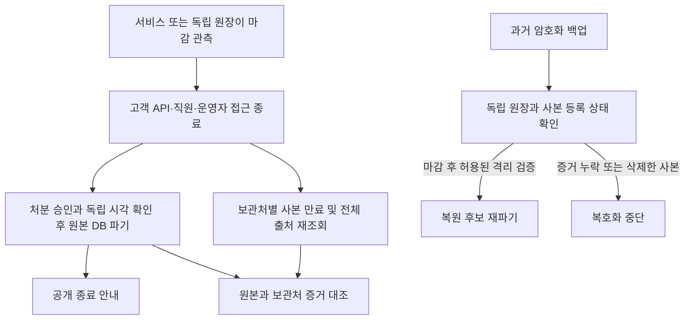

# ADR-012 · PROD 개인정보 접근 종료, 파기와 과거 백업 복원

- 결정 기준은 2027-03-31 00:00:00 KST, UTC로 2027-03-30 15:00:00이다. 사용자가 확정한 접근 종료·파기 시각이며 일상 백업의 보유기간은 미승인이다. [행사 생명주기](ADR-008-event-lifecycle.md)
- 2026-11-26 구현 범위는 로컬 PROD 후보와 합성 데이터다. 과거 DEMO의 복구 정책과 신규 PROD DB의 출발점을 기록한 [ADR-010](ADR-010-prod-card-recovery.md), 공개 접속과 가입 승인을 분리한 [ADR-011](ADR-011-prod-environment-and-enrollment.md)을 잇는다. 구현·시험 주체는 Codex다.

## 파기 대상과 남는 데이터

| 실제 테이블 | 포함 데이터와 분류 | 종료 처리 |
|---|---|---|
| customers | 카드 ID와 생성·수령 시각. 다른 자료와 결합 가능한 고객별 운영 기록 | 모든 행 삭제 |
| customer_profiles | 등록 이름, 검색 가능한 전화번호 HMAC, 카드 ID와 안내 확인 내역. 직접·간접 식별자 | 모든 행 삭제 |
| customer_contacts | 전화번호 암호문·마스크, 수신 키 식별자, 카드와 저장 시각. 연락 가능한 개인정보 | 모든 행 삭제 |
| sessions | 고객 세션 검증값, CSRF 값, 카드 ID와 만료 시각 | 요청 거부, 모든 행 삭제 |
| stamps | 고객·상품·적립 시각. 카드와 연결되는 활동 | 모든 행 삭제 |
| reward_audit | 카드별 보상 시각과 지급 방식 | 보존 의무 검토 대상, 승인된 파기 범위에 포함된 경우 모든 행 삭제 |
| stamp_cancel_audit | 카드·상품·직원과 취소 전후 시각 | 동일한 승인 조건으로 모든 행 삭제 |
| stamp_correction_audit | 요청·카드·관리자, 상품과 사유 자유문, 적립·정정 시각과 자격 | 같은 조건으로 모든 행 삭제. 평상시 수정·삭제 방지 트리거 유지 |
| contact_access_audit | 운영자, 요청 ID, 카드 ID, 목적과 결과. 실제 카드가 없는 조회도 포함 | 같은 조건으로 모든 행 삭제 |
| admin_sessions | 직원·관리자 세션 검증값, 직원 ID, CSRF와 시각 | 두 역할 모두 거부, 모든 행 삭제 |
| products, metadata | 상품·QR 매핑, 행사 서명, 인스턴스·스키마·키 검증 및 역할 바인딩. 사용자별 이력 없음 | 승인된 구조만 유지. 로컬 종료 표시 추가. 알 수 없는 테이블·메타데이터는 파기 중단 및 분류 |
| SQLite 내부 자료, 원본 외 사본 | 통계 표본, 여유 페이지, WAL, 평문 임시본, 이전 DB, 복원 후보, 보관소 버전에도 고객 정보가 남을 수 있음 | 통계 제거·압축·WAL 비우기와 별도 사본 인벤토리·삭제 증거를 각각 확인 |

PROD에는 개인 복구 토큰 테이블이 없다. 고객별 감사를 해시로 바꿔 계속 보관하지 않는다. 통계를 장기 보존할 별도 사업 요건도 없어 이번 구현은 통계 테이블을 만들지 않는다. 운영 증거에는 행사와 인스턴스, 완료 시각·상태, 사본의 불투명한 식별자와 삭제 증거의 지문만 필요하다. 직원 자격 파일과 행사 키의 폐기는 별도 자격 관리 절차다. [실제 스키마](../../app/schema.sql) · [연락처](../../app/contact_schema.sql) · [정정](../../app/correction_schema.sql) · [파기 코드](../../deploy/linux/prod_purge.py)

## 접근 종료와 파기 결정

인증 쿠키나 직원 권한이 있어도 마감 뒤에는 고객 정보를 받지 못한다. 서비스와 독립 보관 호스트 중 어느 쪽이 먼저 마감을 관측해도 접근을 닫는다. 시각 비교는 시간대가 있는 행사 설정을 epoch로 변환한다. DB 쓰기 잠금 획득 뒤, 커밋 직전, 개인 정보 응답을 넘기기 직전에 다시 검사한다. 읽기와 쓰기에 외부 확인 시간이 추가된다. 원장 연결이 끊어지면 진행 중인 서비스는 개인 정보를 제공하지 않고 새 프로세스는 검증 가능한 상태에서만 기동한다. [요청 처리](../../app/app.py) · [운영자 SSH](../../deploy/linux/prod_contact_ssh.py) · [기동과 파기 명령](../../deploy/linux/prod.py)

독립 호스트가 자기 시계로 파기 시각을 확인하고, 감사자료 처분과 복원 연습 및 인벤토리에 대한 증거가 있어야 물리 파기를 허용한다. 법적 보존 범위는 프로그램이 결정할 수 없다. 보존 의무가 확인되거나 범위가 불명확하면 접근을 닫고 승인 범위를 확정한다. 현재 명령은 명시적으로 승인한 전체 범위만 처리한다. 별도 보존이 필요한 자료가 있으면 선별·격리 설계를 먼저 승인해야 한다.

## 독립 원장과 복원

DB에만 완료 표지를 남기면 이전 백업 복원 때 표지도 사라진다. 서명된 과거 상태 파일 역시 최신이라는 근거가 없다. 별도 관리자와 저장소·시계를 가진 호스트가 행사·인스턴스별 원장을 보관하고 상호 TLS로 요청마다 새 난수를 확인한다. 접근 종료, 파기 시각 도달, 활성 DB 처리, 각 사본 삭제와 전체 출처 재조회가 서로 다른 상태다. 영수증은 고객 단말 자격으로 작성할 수 없으며, 활성 DB 파기의 원격 보고에는 별도로 고정한 서비스 인증서가 필요하다. [원장과 권한](../../deploy/linux/prod_authority.py)

암호화 백업에도 고객 자료가 남는다. 확인되지 않은 사본이나 제공자 스냅샷이 있으면 전체 파기 완료가 아니다. 복원 전 원장과 등록 사본을 확인하고, 종료 후에는 격리 경로에서 파기를 다시 적용한다. 복원 후보가 활성 DB 완료를 보고하지 않는다. 만료 처리가 끝난 사본은 복원에 사용할 수 없다. [백업 및 복원](../../deploy/linux/prod_backup.py) · [보관소 절차](../PROD_BACKUP_EXPIRY.md)

다음 흐름에서 서비스가 실제로 재개할 수 있는 것은 종료 안내다. 백업의 삭제가 늦어져도 고객 데이터 접근이 다시 열리지는 않는다.

## 한계와 인수

파일 삭제·SQLite 비우기는 클라우드 스냅샷, 매체 내부의 이전 블록, 호스트 스왑이나 담당자가 별도로 내보낸 사본의 삭제 증명이 될 수 없다. 운영 전 암호화된 볼륨과 스왑, 코어 덤프 제한, 장치·제공자별 모든 사본과 삭제 방식, 별도 담당자와 증거 보관을 확인한다. 보관 원장과 활성 서비스 인증서를 같은 VM 이미지에 보관하거나 과거 원장을 복구·재발급해 재개하면 신뢰 가정이 깨진다. 원장이 소실되면 최신 상태와 외부 증거를 회복하기 전 기동하지 않는다. 본인에게 이미 전송된 화면·출력·촬영본을 원격으로 회수할 수 없다. [실행 기록](../devlog/DEV-020-prod-privacy-erasure.md)
